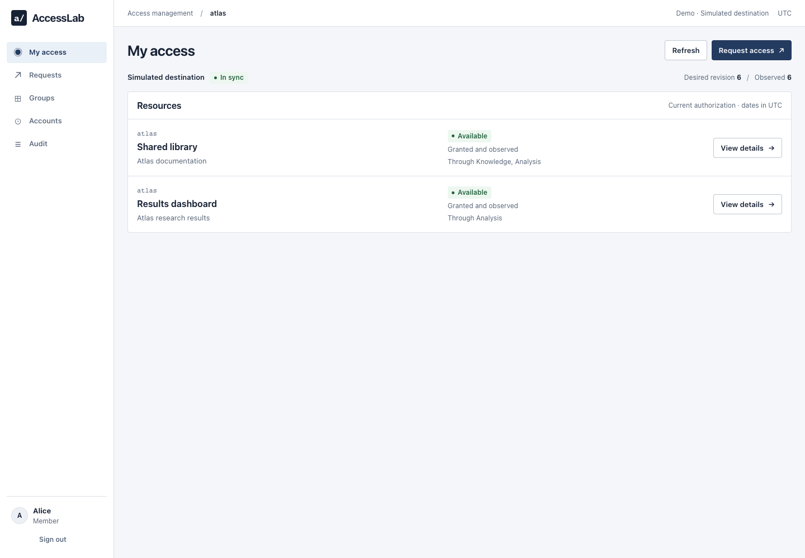

# AccessLab

[](https://github.com/airope/AccessLab/actions/workflows/ci.yaml)
[](LICENSE)

AccessLab is an open-source application for **explainable, time-bound access management**. Members request access, reviewers inspect its impact before deciding, and operators follow application, expiration and recovery. The included workspace uses fictional research projects and identities.

The important distinction is **approved ≠ applied**. PostgreSQL holds desired state; the connector's last acknowledgement explains synchronization progress, while the simulator's actual grants determine whether application has occurred. Authentication is real OpenID Connect through Keycloak; the destination connector is not a real directory integration.



Actual local-browser capture with fictional fixtures, not a design mockup.

[Watch the 27-second real-browser walkthrough](docs/assets/AccessLab-demo.mp4): prepare, preview, independent review, applied access and operations. Authentication exchanges are deliberately excluded from the recording.

## Stack and verification

The application brings together account lifecycle, project-scoped groups, resource eligibility and temporary membership requests. A server-generated preview explains what a change adds, removes or retains. Independent approval, correlated audit records and retry diagnostics make each decision traceable through to its effect.

- ASP.NET Core / EF Core / PostgreSQL, with a React + TypeScript frontend served from the same origin.
- Confidential BFF OIDC client, authorization code + PKCE, server-side cookie session; no browser-stored access tokens or role-selector authentication.
- xUnit domain/HTTP/database tests, frontend component tests, and real-Keycloak Playwright acceptance.
- Pinned runtime/build baseline: .NET SDK **10.0.400**, .NET runtime image **10.0.9**, Node **26.5.0**, PostgreSQL **17.11**, Keycloak **26.7.4**, Java **21** for native Keycloak. Package versions are in the project files and npm lockfiles.

See [verification evidence](docs/VALIDATION.md) and the [requirement-to-test map](docs/COVERAGE.md) for tested behavior and remaining limits. The status badge links to the actual CI run; it is not a security certification.

## Quick start — local containers

Prerequisites: Docker with Compose v2 (`--wait` support), Python 3.11+, and .NET SDK 10.0.400 for the local HTTPS certificate. Use a fresh directory with this repository's files, not an existing application's configuration.

```sh
git clone https://github.com/airope/AccessLab.git
cd AccessLab
python3 scripts/setup.py --certificate
python3 scripts/test_setup.py
docker compose up -d --build --wait --wait-timeout 300
```

Open **https://localhost:5443**. The exported .NET development certificate is not automatically trusted. Approve only your local development certificate in your browser, or explicitly run `dotnet dev-certs https --trust` yourself if you want to alter your trust store. Never use these certificate exceptions for a public service.

Choose **Sign in** to reach the real Keycloak login at `http://localhost:58080`. Passwords are generated uniquely into **`.local/credentials.json`** (`users.alice.password`, etc.). Open that private file locally; do not paste it into issues, chat, screenshots, or commits. It is deliberately not a web-served file.

| Identity | Purpose |
|---|---|
| Alice | Atlas member; initially has Knowledge membership |
| Bob, Dana | Independent Atlas reviewers |
| Claire | Global service operator, also an Atlas member |
| Eve | Reviewer for the separate Nova project |
| Frank | Atlas auditor |
| Unknown | Real IdP identity with **no** local application account |

All configured accounts also have Member role. IdP roles never grant application privileges. The app maps the exact issuer and stable subject to its local account.

**Native alternative (no Docker):** follow [the runbook](docs/RUNBOOK.md#native-development-no-docker). The reference PostgreSQL port is 55432; setup can select and remember another native port. Never stop another database just to free the reference port.

## Try the workflow

1. Sign in as Alice and inspect My access. Knowledge grants Library, not Results.
2. Request a bounded Analysis membership, give a reason, preview the impact, then submit. A request is not a grant.
3. Sign out locally, then use a separate browser context for Bob. Review, refresh impact, and approve. Alice cannot approve her own request; neither can a reviewer who authored it.
4. Observe Approved with sync pending before In sync. Alice can use newly granted content only when current local authorization and the simulator's actual grant both permit it.
5. Preview removal of Analysis: Results is removed, Library is retained through Knowledge.
6. As Claire, use the demo-only connector failure control, make an independently approved change, inspect pending/failed operations, disable failure, and retry. Retry reconciles current state; it is not an entitlement override.
7. Suspend Alice with a reason. Her existing session must not preserve business access. Ended is terminal. Reset the disposable application fixture before repeating destructive demos.

These are demonstration scenarios, not substitutes for test evidence. To switch identities in one browser, choose **Sign out → Use another account → Restart login** on Keycloak. Normal login retains SSO. Local logout clears the application session, not every session in every relying party.

## Tests

With dependencies installed and PostgreSQL/Keycloak running, `python3 scripts/verify.py --browser` executes the local configuration, private-material, dependency-readiness, backend, frontend and browser gates. **Stop the native API first.** Browser verification creates a fresh scratch database and starts its own newly built API on the registered local callback origin. It refuses an occupied port and never resets the demonstration database. Restart the normal API afterwards. External audit-service failures remain failures, not a green security result.

Against the native local services:

```sh
python3 scripts/test_setup.py
python3 scripts/native.py ready
python3 scripts/native.py test --configuration Release
npm --prefix src/AccessLab.Web ci
npm --prefix src/AccessLab.Web test
npm --prefix src/AccessLab.Web run build
python3 scripts/check-secrets.py
```

For isolated native browser acceptance, leave PostgreSQL and Keycloak running but stop the normal API:

```sh
npm --prefix tests/e2e ci
npm --prefix tests/e2e exec -- playwright install chromium
ACCESSLAB_BROWSER=chromium python3 scripts/e2e.py
python3 scripts/native.py api
```

The default local browser channel is installed Google Chrome. CI installs Chromium and overrides the channel. Backend integration tests receive `ACCESSLAB_TEST_DATABASE` from the native launcher and use a separate real PostgreSQL database. Native browser tests use a unique `accesslab_e2e_*` database, removed after the runner stops its own process. The same-origin port is reused to preserve the exact registered OIDC callback; the runner does not stop an existing process. Direct mutating browser runs require an explicit isolated-environment flag; it is an operational guard, not an authentication bypass. Test-only authentication exists only in the backend test host; browser acceptance uses real OIDC.

## Structure and boundaries

- `src/AccessLab.Api/`: identity boundary, local authorization, workflow, EF migrations, outbox, simulator and HTTP API.
- `src/AccessLab.Web/`: frontend; no authoritative client-side permissions.
- `tests/`: backend and browser acceptance; frontend tests live with the frontend.
- `scripts/`, `infra/`, `compose.yaml`: reproducible private fixture setup and local service launch.
- [Architecture](docs/ARCHITECTURE.md) · [API](docs/API.md) · [Runbook](docs/RUNBOOK.md) · [Security model](docs/SECURITY.md) · [Walkthrough](docs/DEMO.md) · [Specification](docs/SPECIFICATION.md) · [Coverage](docs/COVERAGE.md)

Audit is append-only at the application boundary, **not immutable storage** and not tamper-proof against a database administrator. The simulator shares the backend/database infrastructure and does not establish guarantees about a real remote provider. HTTP Keycloak, fixture privileges, root container execution for private bind mounts, and demo failure injection are local-development choices. Public deployment requires a separate reviewed configuration, HTTPS IdP, least-privilege service accounts, secret management, rate limits, backups, and disabled fixtures/failure controls.

## Contributing and license

Focused bug fixes, documentation improvements and design proposals are welcome. See [CONTRIBUTING.md](CONTRIBUTING.md) for setup and review expectations, and [SECURITY.md](SECURITY.md) for private vulnerability reporting.

Released under the [MIT license](LICENSE). Third-party components retain their own licenses. Development uses AI-assisted tooling; contributors remain responsible for understanding and verifying their changes.
