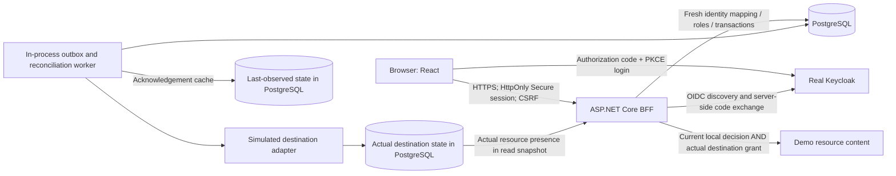

# Architecture

## Scope and proof boundary

AccessLab is a modular monolith for one fictitious organization, two isolated projects, non-nested groups and fixed versioned eligibility rules. This document describes its design and operational contracts; consult [VALIDATION.md](VALIDATION.md) for measured acceptance coverage. It is not a claim of external directory integration or certified security.

## Authentication versus authorization

The browser receives an application cookie, not an OIDC token. Standard ASP.NET middleware handles code flow, PKCE, state, nonce, signature and token validation. The confidential client is `accesslab-web`; its secret is generated privately. Exact local redirect URI: `https://localhost:5443/signin-oidc`. Authority and validated issuer: `http://localhost:58080/realms/accesslab`. HTTP metadata is permitted only in Development.

Identity mapping uses **issuer + immutable subject**, not email, a request header, browser role selection, or IdP role claims. A valid Keycloak user without a configured active local account receives no business permissions. Account status, roles and project scopes are application data and must be checked afresh. Operator access does not itself grant business resource content. Author and beneficiary self-review prohibitions override combined roles.

Mutation boundaries require the session, fresh authorization, CSRF token, idempotency key, and validated arguments. Return URLs must remain local. UI visibility is only guidance; direct HTTP calls face the same checks. Unknown `/api` paths must not fall back to SPA HTML.

## Data and decision flow

PostgreSQL is authoritative for accounts, project affiliations, scoped role grants, groups, memberships, resources/rules, requests, previews, audit, idempotency records, outbox and desired/observed revisions. EF migrations are the schema history. No application state is solely browser-local.

1. A server-generated preview stores normalized arguments and dependency versions. Submission references its identifier rather than replaying a browser-authored diff.
2. Reviewer preview is separate from requester preview. Validity is bounded by five minutes **and** the next relevant time boundary.
3. Approval rechecks actor, scope, terminal state, account/dependency revisions and UTC bounds while holding ordered database locks.
4. Decision, membership, audit and outbox commit atomically. Database constraints prevent overlapping memberships; concurrent approval cannot produce duplicate logical effects.
5. A durable worker reconciles complete desired projections to the simulated destination. Projection revisions are monotone and identify immutable content. Old deliveries cannot overwrite a newer projection.
6. Local authorization uses current account and membership validity even while the worker is stopped. Demo resource content additionally requires its specific **actual destination grant**, not the last-observed acknowledgement cache; an unrelated pending change must not revoke an unchanged resource.

Access diagnostics and protected-content reads open a PostgreSQL **read-only RepeatableRead transaction before actor resolution**. Actor authority, current membership and actual destination presence are evaluated in one consistent database snapshot. This prevents mixed pre-/post-change reads; it does not promise to cancel a response already authorized in a snapshot preceding a concurrent revocation. Subsequent requests re-evaluate authority, including requests using an old session.

The accepted request retains the server preview and serialized decision context, preserving the approved arguments, effects and explanation after dependencies change. That historical context is not a reusable permission. Idempotent replay remains actor-scoped and rechecks current authority; a changed payload conflicts rather than creating another effect.

Time intervals are start-inclusive/end-exclusive UTC. `AccessLab:MaxMembershipDays` defaults to 90, accepts 1–3650 at startup, and is exposed through the session for UI validation. Preview calculation refuses more than 200 relevant future time boundaries or a decision-context snapshot over 64 KiB with `400 preview_too_complex`; it does not silently truncate effects. Removed membership history does not consume the future-boundary budget. Approval means a desired change was committed, not that a destination applied it. Five consecutive connector failures lead to Failed; authorized retry computes current state instead of replaying a stale grant.

## Local topology and issuer consistency

Native services use separate processes. PostgreSQL binds 127.0.0.1 (default 55432, explicitly selectable); Keycloak binds 127.0.0.1:58080; management health binds 127.0.0.1:9000. The app binds HTTPS localhost:5443 and serves the production frontend build itself.

Compose preserves the same issuer without DNS rewrites: app uses `network_mode: service:keycloak`, so its loopback reaches Keycloak at localhost:58080. The Keycloak service publishes both 58080 and app 5443 on **host loopback only**. PostgreSQL remains reachable by service name inside that network. Ordered authenticated database health → Keycloak health → API health avoids boot races. Management port 9000 is not published.

This unusual shared-network choice is intentionally small and local. Do not copy localhost issuer settings into a public deployment. Public use needs a stable HTTPS issuer resolvable identically from browsers and backend, exact HTTPS callbacks and a separate security review.

## Persistence and secrets

Generated `.local/` is ignored, owner-only, and excluded from image build contexts. Credential-bearing files are mode 0600, directory 0700. The native launcher injects private configuration into child environment without printing it. Compose mounts only the private realm, certificate, application config and database password it needs, not all of `.local/`.

Compose database and ASP.NET data-protection keys persist in named volumes; native equivalents remain project-local. Keycloak has its own database. Keeping data-protection keys prevents arbitrary session invalidation on ordinary restart. Keys are not encrypted at rest by this local sample; host disk permissions are not an enterprise key-management solution. All containers are local-development containers, not hardened deployment artifacts.

## Operational and security limitations

- The connector is simulated in-process; it proves reconciliation semantics, not real network/provider behavior.
- Audit has no application edit/delete route, but database administrators can change data. No WORM storage, cryptographic audit chain, or certification is promised.
- Local logout does not promise global IdP revocation. Existing sessions remain bounded by application checks and expiration.
- Fixture role grants are installation data, never an entitlement request type. Demo mode only enables connector failure simulation.
- Default developer database role is a local superuser for reproducible initialization/migrations, not a production least-privilege design.
- Public hosting, nested groups, SCIM, policy editing, multi-tenancy and Kubernetes are out of scope.
